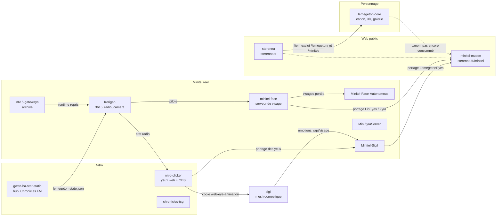

# Audit de l'écosystème Lemegeton — 2026-10-14

But : savoir ce que nous avons, ce qui sert, pourquoi, et comment les dépôts
dépendent les uns des autres, **avant** toute réorganisation. Aucun code n'a été
modifié pour cet audit.

Méthode : lecture des dépôts locaux et de leur branche distante après `git fetch`
(certains clones locaux étaient en retard, voir § 6 ; mis à jour depuis, voir § 8), requêtes `gh` (visibilité, PR,
issues), contrôle HTTP des pages publiques, relevé des processus en cours sur le
PC principal. Les dépôts privés sont décrits sans détail d'infrastructure, car ce
dépôt est public.

## 1. Vue d'ensemble

## 2. Fiches par dépôt

État : **actif** (commits dans les 90 derniers jours et en service), **en
service figé** (en ligne mais plus touché), **référence** (sert de modèle, plus
exécuté), **archive**.

### Personnage

| | lemegeton-core |
| --- | --- |
| Visibilité | public |
| Activité | 14 commits, dernier le 2026-10-14 |
| En ligne | [sterenna.fr/lemegeton](https://sterenna.fr/lemegeton/) (200) |
| Ce qu'il apporte | Références 2D, sources 3D, 4 versions de rig, scènes Blender, rendus, galerie, canon |
| Pourquoi c'est utile | Seul endroit où le personnage existe comme création ; source des visuels publics |
| Point faible | 94 Mo versionnés sur 2,4 Go : l'essentiel (Blender 1,5 Go, rigs 0,4 Go) n'existe qu'en local |
| État | **actif** |

### Web public

| | minitel-musee | sterenna |
| --- | --- | --- |
| Visibilité | public | privé |
| Activité | 101 commits, dernier le 2026-10-14 | 89 commits en 90 j |
| En ligne | [sterenna.fr/minitel](https://sterenna.fr/minitel/) (200) | [sterenna.fr](https://sterenna.fr/) (200) |
| Lemegeton | Service 3615 LEMEGETON, yeux sur l'écran Vidéotex (2 moteurs portés) | Lien vers le carnet ; exclut `/lemegeton/` et `/minitel/` de son déploiement |
| Pourquoi c'est utile | Vitrine publique la plus aboutie ; seule mise en scène 3D du personnage | Porte d'entrée publique |
| Point faible | Ses moteurs d'yeux sont des copies de minitel-face et de Minitel-Sigil | — |
| État | **actif** | **actif** |

### Plateforme Nitro

| | nitro-clicker | gwen-ha-star-static | chronicles-tcg |
| --- | --- | --- | --- |
| Visibilité | public | public | public |
| Activité | 22 commits en 90 j, dernier le 2026-08-02 | 92 commits en 90 j, dernier le 2026-10-13 | 8 commits en 90 j, dernier le 2026-09-30 |
| En ligne | nitro.sterenna.fr/clicker (200) | nitro.sterenna.fr (200), Chronicles FM | nitro.sterenna.fr/TCG (200) |
| Lemegeton | **Origine des yeux** (web-eye-animation), 4 pages OBS, page de réglages, LEMEGETON ordinateur de bord | Animateur de Chronicles FM ; produit `data/lemegeton-state.json` au déploiement | Tutoriel, Sceau de Lemegeton |
| Pourquoi c'est utile | Les pages OBS servent en stream (Twitch, radio) ; référence des yeux pour tous les autres | Publie l'état d'avatar lu par Korigan | Rôle narratif |
| État | **en service figé** | **actif** | **actif** |

### Minitel réel

| | minitel-face | Minitel-Face-Autonomous | Minitel-Sigil | 3615-gateways | Korigan | MiniZyraServer |
| --- | --- | --- | --- | --- | --- | --- |
| Visibilité | privé | privé | privé | public | privé | privé |
| Activité | 20 commits en 90 j | 14 commits en 90 j | 10 commits en 90 j | 0 (dernier le 2026-06-29) | dernier commit distant le 2026-09-27 | 35, dernier le 2026-09-23 |
| Lemegeton | 7 bibliothèques de visages, API `/mood`, `/gaze`, `/seq` | Visages embarqués (humeurs Zyra) | Yeux Lemegeton en G1, suit la mesh Sigil | Page AVATAR / LEMEGETON | Runtime 3615 (avatar), voix Piper, pack vocal, **caméra PTZ pilotée comme regard de Lemegéton**, pilotage de minitel-face, oracle `/leme` | Aucun (serveur Minitel général) |
| Pourquoi c'est utile | Seul moteur de visage multi-styles côté Minitel | Minitel sans serveur | Le Minitel est un terminal de Sigil, en service | Documentation et historique du concept | Plan de contrôle des services, radio | Serveur Telnet MINI-STAR, atelier d'images VDT |
| État | **actif** | **actif** (correctif G1 pas encore flashé) | **actif**, en service (satellite Minitel) | **archive** depuis le 2026-10-14 (le README renvoie vers Korigan) | **actif** (clone local mis à jour le 2026-10-14) | **actif** |

### Autres

| | sigil | goetia, goetia_v2 |
| --- | --- | --- |
| Lemegeton | Page `/visage` (copie de web-eye-animation), émotions envoyées au Minitel | Une mention dans le codex de goetia |
| Lien réel | Fort : pilote le Minitel-Sigil, en service sur le PC principal | Aucun : seule la parenté de nom (Petite Clé de Salomon) les rapproche |
| État | **actif** | hors périmètre (en ligne sur nitro.sterenna.fr/goetia, plus touchés depuis juin) |

## 3. Liens entre dépôts

| De | Vers | Nature | Conséquence |
| --- | --- | --- | --- |
| nitro-clicker | sigil | **copie de fichier** (web-eye-animation) | Deux copies à maintenir |
| nitro-clicker | Minitel-Sigil | **portage** en C++ (LemegetonEyes.h) | Un changement d'émotion doit être reporté à la main |
| Minitel-Sigil | minitel-musee | **portage** en TypeScript (lemegetonEyes.ts) | Idem, troisième exemplaire |
| minitel-face | minitel-musee | **portage** (LibEyes, LibZyraEyes, FaceRenderer) | Correctif G1 du 2026-10-06 reporté dans 3 dépôts |
| minitel-face | Minitel-Face-Autonomous | **portage** des 6 visages | Idem |
| 3615-gateways | Korigan | **reprise du runtime** (`services/3615-gateways`) | Le dépôt public, archivé, n'est plus la version en service |
| Korigan | minitel-face | **pilotage** par HTTP (humeur, regard, séquence, bibliothèque) | Korigan dépend du serveur de visage |
| sigil | Minitel-Sigil | **pilotage** (`/api/visage`, émotions) | En service |
| gwen-ha-star-static | Korigan | **données** : `lemegeton-state.json` publié sur nitro.sterenna.fr, lu par l'avatar 3615 | Vocabulaire hors canon (eyes/mouth/mood libre) |
| Korigan | nitro-clicker | **données** : état radio lu par l'overlay OBS radio | Voir § 6 |
| sterenna | lemegeton-core, minitel-musee | **déploiement** : exclusions dans le `rsync --delete` du site | Tout nouveau sous-site doit y être exclu |
| lemegeton-core | minitel-musee | **canon** et futur export Web des modèles | Pas encore consommé par le code |

## 4. Doublons et lignées

**Moteurs d'yeux** (5 représentations) :

1. web-eye-animation, nitro-clicker → copie dans sigil ;
2. LemegetonEyes.h (Minitel-Sigil) → lemegetonEyes.ts (minitel-musee) ;
3. bibliothèques minitel-face → Minitel-Face-Autonomous et minitel-musee ;
4. SmoothEyes (minitel-musee), rendu lisse façon overlay ;
5. PtzEyes (Korigan), yeux React qui reflètent le regard de la caméra PTZ.

**Serveurs Minitel** (deux lignées parallèles) :

- 3615-gateways → `Korigan/services/3615-gateways` (Node), porte l'avatar Lemegeton ;
- MiniZyraServer, consolidation de MINISTARDEV (Python, Telnet MINI-STAR), sans
  Lemegeton ; Korigan et MiniZyraServer ont chacun un audit de comparaison avec MINISTARDEV.

**Voix** : Piper avec `lemegeton.onnx` et le pack de 10 phrases dans Korigan ;
`audio/leme` dans gwen-ha-star-static. Le mot d'éveil de Sigil est un autre modèle
et ne concerne pas Lemegeton.

## 5. Éléments de travail hors Git

| Où | Volume | Contenu |
| --- | --- | --- |
| lemegeton-core (local) | ~2,3 Go non versionnés | Blender 1,5 Go, rigs 0,4 Go, exports 155 Mo, sources 3D 130 Mo, modèles 97 Mo |
| Dossier d'assets Cyber Djinn | 274 Mo | Exports et textures, hors dépôt |
| minitel-musee `sources/` | 573 Mo | Sources des terminaux |
| minitel-musee `docs/archive_minitel/` | 479 Mo | Archive Goto10 (exécutables, droits de tiers) |
| minitel-musee `monde/` | 26 Mo | Sources du monde explorable (Poly Haven, porte) |
| Firmwares | — | Hors de l'arborescence des dépôts (dossier Arduino) ; poussés sur GitHub |

Une copie de travail unique des binaires est un choix assumé. Ce relevé dit
seulement où ils se trouvent, pour qu'un regroupement n'en oublie aucun.

## 6. Points d'attention

- ~~**Clones locaux en retard**~~ (réglé, § 8) : Korigan (136 commits de retard, dont la caméra
  PTZ de Lemegéton et des évolutions de la radio), goetia_v2 (44),
  gwen-ha-star-static (4). **minitel-face a divergé** : 1 commit local non poussé
  (« Add local Minitel command reference ») et 2 commits distants (PR #7).
- **Overlay OBS radio** : il lit l'état sur korigan.sterenna.fr, qui répond 401 sans
  session. À vérifier en conditions réelles dans OBS.
- **Oracle `/leme`** : la page de Korigan intègre un service externe dont l'adresse
  est une variable d'environnement ; aucun dépôt local ne contient ce service.
- **État de la radio hors canon** : `lemegeton-state.json` nomme yeux et bouche à
  sa façon et décrit l'humeur en texte libre.
- ~~**3615-gateways**~~ (archivé, § 8) est public et présenté comme prototype ; la version en service
  est privée, dans Korigan.

## 7. Propositions de tri (sans code)

1. ✅ **Mettre à jour les clones locaux** (Korigan, goetia_v2, gwen-ha-star-static) et
   **résoudre la divergence de minitel-face**, pour que les audits suivants partent
   de la bonne version.
2. ✅ **Marquer 3615-gateways comme archivé** sur GitHub (lecture seule), puisque son
   README le désigne déjà comme référence historique.
3. **Retirer goetia et goetia_v2 du périmètre** : aucun lien fonctionnel.
4. **Décider la place de MiniZyraServer** : serveur Minitel général, sans
   Lemegeton ; il fait partie de l'écosystème Minitel, pas du personnage.
5. **Désigner une référence par famille d'yeux** dans le canon : web-eye-animation
   (nitro-clicker) pour les émotions, minitel-face pour les humeurs. Les autres
   exemplaires sont alors des portages déclarés.
6. **Garder ce rapport à jour** à chaque nouvelle apparition de Lemegeton, avec
   [canon/apparitions.json](../canon/apparitions.json).

## 8. Suivi

### 2026-10-14 — propositions 1 et 2 faites

- **Clones mis à jour** (avance rapide, aucune modification locale) : Korigan
  (136 commits rattrapés, dernier commit le 2026-09-27), goetia_v2 (44),
  gwen-ha-star-static (4).
- **minitel-face** : le commit local « Add local Minitel command reference »
  a été replacé après la PR #7 et poussé (`049938c`) ; la branche locale
  fusionnée `docs/lien-minitel-musee` a été supprimée. Reste la branche locale
  `feat/web3d-minitel` (1 commit jamais fusionné, branche distante supprimée,
  ancienne intégration 3D remplacée par minitel-musee), gardée en attendant une
  décision.
- **3615-gateways archivé** sur GitHub (lecture seule, réversible) ; noté dans
  [canon/apparitions.json](../canon/apparitions.json).

### Hors périmètre Lemegeton, relevé pendant l'audit

Les sous-sites `nitro.sterenna.fr/zevent-booster/` et `/rpg/` étaient en 404 :
le déploiement de gwen-ha-star-static synchronise `~/nitro/` en supprimant tout
dossier absent de sa liste d'exclusions, et ces deux-là n'y figuraient pas.

- **zevent-booster** : écarté du site (décision de l'utilisateur) ; son
  déploiement était déjà désactivé.
- **Aphalone — Crystal Quest** (ex-`/rpg/`) : intégré à Skill Arena, en ligne sur
  `nitro.sterenna.fr/arena/games/aphalone/` (skill-arena #12, README repris en
  #13) ; le dépôt `aphalone-crystal-quest` est archivé et son déploiement désactivé.
- Tout nouveau sous-site publié sous `~/nitro/` par un autre dépôt doit être ajouté
  aux exclusions du déploiement de gwen-ha-star-static.

### Restent ouverts

Propositions 3 à 6, et les points d'attention sur l'overlay OBS radio, l'oracle
`/leme` et l'état de la radio hors canon (§ 6).
